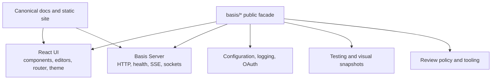

# Architecture

Basis is a Bun-first monorepo distributed as a pinned Git dependency. It is one deliberately integrated implementation: the React UI, application server, configuration, logging, OAuth, testing, review policy, and repository tooling share conventions, ownership, and a coordinated release.

The root `package.json` is the public facade. Consumers import supported surfaces (`basis/react`, `basis/server`, `basis/configuration`, `basis/logger`, `basis/oauth`, `basis/review`, `basis/testing`, `basis/cli`, and related tooling) and resolve the pinned source without reaching into workspace paths.

## System shape

The surfaces are not independent products with a shared marketing name. They are parts of one system with a common release, common class-based UI contract, common configuration and runtime conventions, and one review and validation policy. Each package remains internally owned and does not reach into another's implementation through convenience paths.

## Invariants

- The consumer surface resolves without Basis-monorepo path aliases or `node_modules/basis/libraries/*` imports.
- Internal code imports public surfaces by their consumer names (`basis/react`, `basis/server`, …), resolved locally by the root `tsconfig.json` remap, and imports internal-only workspaces package-relatively. The published surface resolves through `exports` alone.
- Runtime dependencies are declared in the root `dependencies`; host capabilities are declared as `basis.hostDependencies` metadata and validated by the install hook rather than exposed as an imperative API.
- UI is class-based. Application components extend the Basis `Component` or `Editor` hierarchy; React function components, `React.FC`-style component types, `memo`/`forwardRef` function components, and React hooks are outside the contract. `@basis/component-architecture` enforces this through `basis lint`, `basis check`, and the focused `basis compliance` command.

## Deliberate boundary

Basis chooses coherence and completeness within its chosen scope over universal interoperability. New external dependencies and integrations are added when a concrete requirement earns them, not through speculative adapters or configuration for every ecosystem.

The `basis/*` facade is the supported **integrated** consumer contract. It is not a prohibition on copying, reusing, or adapting open-source Basis internals in another system with different conventions. Selective reuse does not require adopting Basis's other policies.

## Documentation and release

The documentation site is built from the canonical `docs/` tree and the live route inventory. The same article and navigation model feeds the development app and the static build. Basis releases from `main` after merge; the epic branch may integrate intermediate database work under the same checks before its coordinated release.

Further detail lives in [Engineering Principles](./engineering-principles.mdx), [Reference](./reference.mdx), and the package pages.
