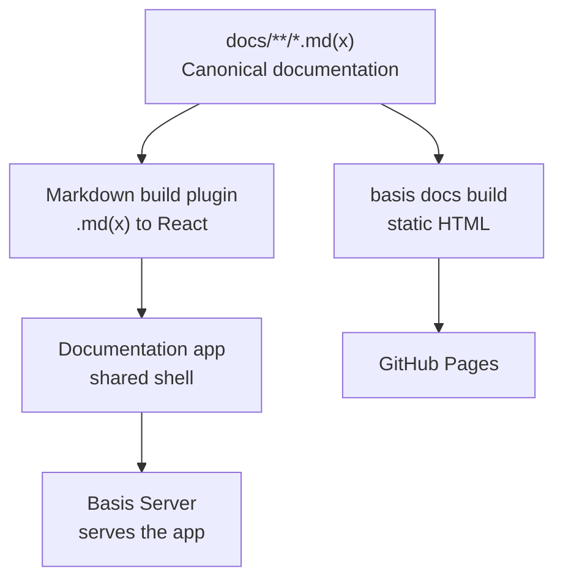

# Architecture

Basis is a Bun-first monorepo distributed as a pinned Git dependency. The root `package.json` is the public facade: consumers import stable source surfaces (`basis/react`, `basis/server`, `basis/logger`, `basis/review`, `basis/configuration`, `basis/eslint`, `basis/markdown`, `basis/stylelint`, `basis/tsconfig/*`) and never reach into workspace paths.

## Invariants

- The consumer surface resolves without Basis-monorepo path aliases or `node_modules/basis/libraries/*` imports.
- Basis has one import vocabulary. Internal code imports the public surfaces by their consumer names (`basis/react`, `basis/server`, …), resolved locally by the root `tsconfig.json` `paths` remap, and imports internal-only workspaces package-relatively. The published surface still resolves through `exports` alone, without aliases.
- Runtime dependencies are declared in the root `dependencies`; host capabilities are declared as `basis.hostDependencies` metadata and validated by the install hook rather than exposed as an imperative API.
- UI is class-based. Application components extend the Basis `Component` or `Editor` hierarchy; React function components, `React.FC`-style component types, `memo`/`forwardRef` function components, and React hooks are outside the contract. `@basis/component-architecture` enforces this through `basis lint`, `basis check`, and the focused `basis compliance` command.

## Where the detail lives

The documentation site built from this tree is the authoritative reference for package APIs, usage, and developer guidance. Root and workspace `README.md` files are concise front doors: what the package does, the minimal quick start, and links to the relevant site pages. They are not parallel API inventories. This tree carries the durable, cross-cutting architecture prose and the invariants above.

## System shape

