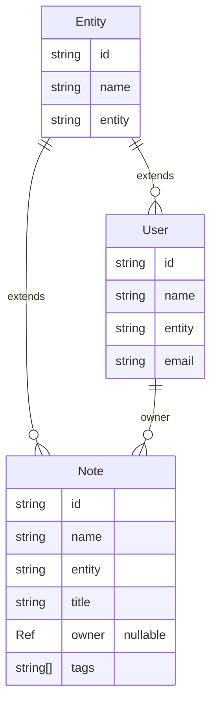

# Typed Authoring & Generated Products

`graph.ts` is the application's single authored source of truth. Importing it constructs the canonical in-memory `Graph`, which validates the complete ontology once and is the model used by query, authorization, DDL, type, schema, and ERD consumers.

```ts
import { Cardinality, Constraint, FieldType, Graph } from 'basis/server'

export default new Graph({
  enums: {
    AccessLevel: {
      editor: 'Can edit resources.',
      owner: 'Can manage resources and membership.',
      viewer: 'Can view resources.',
    },
  },
  entities: [
    {
      fields: [
        { field: 'email', type: FieldType.String },
        {
          cardinality: Cardinality.Many,
          field: 'notes',
          inverse: 'owner',
          target: 'Note',
          type: FieldType.Inverse,
        },
      ],
      name: 'User',
    },
    {
      constraints: [{
        description: 'A retired note is never active.',
        name: 'retiredNotesAreInactive',
        type: Constraint.Validation,
        where: 'retiredAt = null OR active = false',
      }],
      fields: [
        { field: 'title', type: FieldType.String },
        { default: false, field: 'active', type: FieldType.Boolean },
        { field: 'access', type: FieldType.Enum, enum: 'AccessLevel' },
        { field: 'email', type: FieldType.String, unique: true },
        { field: 'retiredAt', nullable: true, type: FieldType.Timestamp },
        { field: 'owner', inverse: 'notes', target: 'User', type: FieldType.Entity },
        { field: 'tags', items: { type: FieldType.String }, type: FieldType.Array },
        { field: 'metadata', type: FieldType.JSON },
      ],
      name: 'Note',
    },
    {
      constraints: [{
        description: 'Each user may only have one Membership per Campaign.',
        fields: ['userId', 'campaignId'],
        name: 'One Membership Per Campaign',
        type: Constraint.Structural,
      }],
      fields: [
        { field: 'userId', target: 'User', type: FieldType.Entity },
        { field: 'campaignId', target: 'Campaign', type: FieldType.Entity },
      ],
      name: 'Membership',
    },
    { fields: [], name: 'Campaign' },
  ],
})
```

The typed declaration accepts the same entity, relationship, enum, array, JSON, reference, inverse, MTI, identity-format, nullable, default, and uniqueness shapes as canonical JSON. There is no decorator syntax, second registry, or alternative validator. Omitting `nullable` preserves the non-null default for scalar, array, and JSON fields; reference fields remain nullable by default unless `nullable: false` is declared. An optional `default` supplies the column default and must match the declared field type. `unique: true` and named `Constraint.Structural` declarations normalize into PostgreSQL unique indexes through the same Graph/DDL path. `Number` fields may declare inclusive `minimum`/`maximum`; `String` fields may declare `minLength`/`maxLength`. These bounds are canonical Graph metadata, validation constraints for mutations, and PostgreSQL `CHECK` constraints, not a mutation-only schema. JSON remains an alternate input syntax for tools that load a parsed document; it feeds the same `Graph` construction path. A `Graph` is passed directly to `Server.graph(graph)`.

The Graph-root `enums` dictionary maps each persisted string value directly to its description. An `Enum` field names one enum and persists as text with a named allowed-value `CHECK`; TypeScript emits a real `enum` with JSDoc per value, and JSON Schema emits one reusable `$defs` entry referenced by every consuming field. Editing only a description changes generated contracts without a database migration.

`Constraint.Validation` adds one named, described positive valid-state predicate. Its `where` uses the canonical predicate grammar, including field-to-field paths such as `revision.owner`, and is evaluated against the transaction-final state of Graph-native `create`/`edit`/`upsert`/`delete` writes before `db.tx` commits. `TRUE` passes; `FALSE` or `UNKNOWN` fails and rolls back the whole transaction. This is application-authored Graph validation, not a generated trigger, database-side predicate runtime, or a second transaction manager. Entity constraints apply to affected Graph-native records and their descendants; relationship constraints use the same paths but have no Graph-native edge-write boundary to enforce today.

Every entity inherits the update-tracking fields `lastUpdatedBy` and `lastUpdatedAt` in addition to the universal `id`, `name`, and `entity` fields. The constructed `graph.definitions` is the canonical model. Its narrow ontology queries are intentionally public: `ancestry(name)` returns the entity through its ancestors to `Entity`, `isA(name, ancestor)` includes identity, and `concreteDescendants(name)` returns concrete leaves in declaration order. A concrete entity is its own concrete descendant; abstract names are never returned as leaves; `Entity` covers every concrete leaf. Consumers use these queries instead of walking parent links themselves.

## Generated products

Build-time code generation lives outside the server runtime. The application root supplies a default-exported `graph.ts`; `basis emit` constructs that Graph once, runs the built-in emitters, and then discovers default-exported modules in `emitters/` by convention:

```ts
// graph.ts
import { FieldType, Graph } from 'basis/server'

export default new Graph({ entities: [{ fields: [{ field: 'title', type: FieldType.String }], name: 'Note' }] })
```

```ts
// emitters/CustomEmitter.ts
import { emitter } from 'basis/codegen'

export default emitter({ extension: 'txt', folder: 'custom' }, graph => [{
  content: graph.definitions.entities.map(entity => entity.name).join('\n'),
  name: 'summary',
}])
```

`basis emit` writes beneath `generated/`; `basis typecheck`, `basis lint`, and `basis compliance` run the same lifecycle automatically. No configuration lists emitters, and no custom bundle stage is required.

- Built-in `TypeScriptEmitter` writes `generated/typescript/index.ts`; `JsonSchemaEmitter` writes `generated/json-schema/schemas.json`. Application emitters own their extension, folder, file names, and content.
- `basis/codegen` also exports the pure content generators `generateTypes(graph)` and `generateJSONSchemas(graph)` for consumers that own their own file emission.
- The JSON Schema emitter describes canonical entities only: one `$defs` entry per entity with properties, types, nullability, numeric/string bounds, identity formats, identity-only entity references, and one reusable `$defs` entry per named Graph enum with its persisted values and per-value descriptions. Every stored field is required in the full-entity representation; `null` is expressed through the property value, not by omitting the property. Inheritance composes through `allOf`/`$ref`. It does not emit mutation-operation variants or express authorization and runtime business rules; Basis mutation validation and PostgreSQL RLS remain the authorities for those decisions. Consumers can use `Partial<T>`, `Pick<T, ...>`, or an application-owned projection type.
- `basis/visualization` emits logical and physical Mermaid ERD source. Render it with the existing `Mermaid` component from `basis/react`; visualization never becomes a server runtime dependency.

Emitter modules use the small `emitter({ extension, folder }, generate)` contract. The factory returns an awaitable `(graph, root?) => Promise<void>` and writes each generated file beneath the caller's root; the module owns its extension, folder, file names, and format-specific content. The output root defaults to the process working directory, and declared destinations cannot escape it. The conventional lifecycle invokes application emitters in sorted filename order, so repeated runs overwrite deterministic paths; no stale files are deleted.

Generation is deterministic for a fixed canonical model and must not be maintained as a second schema definition.

## Example generated output

For the typed `User`/`Note` declaration above, the TypeScript emitter includes an entity enum, parent-composed interfaces, and the shared reference identity shape:

```ts
/** Generated from the canonical Basis entity definitions. Do not edit by hand. */

export enum $BasisEntities {
  User = 'User',
  Note = 'Note',
}

export interface Reference {
  readonly entity: $BasisEntities
  readonly id: string
  readonly name: string
}

export interface Entity extends Reference {
  readonly lastUpdatedAt: string | null
  readonly lastUpdatedBy: Reference | null
}

export interface User extends Entity {
  readonly entity: $BasisEntities.User
  readonly email: string
}

export interface Note extends Entity {
  readonly entity: $BasisEntities.Note
  readonly title: string
  readonly owner: Reference | null
  readonly tags: readonly string[]
}

```

Every entity extends `Entity`, which implements the shared `Reference` shape (`id`, `name`, `entity`). Child entities extend their generated direct parent and declare only locally owned fields, while concrete discriminators narrow the abstract parent union. Singular references use `Reference`; there are no per-entity reference types. Generated TypeScript describes entities only; it does not define mutation payloads or validate operations.

The runtime `Database` API accepts ordinary object payloads and validates them against the canonical Graph:

```ts
await server.db.create('Note', {
  name: 'Welcome',
  owner: user.id,
  title: 'Welcome',
})

await server.db.edit('Note', { field: 'id', operator: Operator.Comparison.Equal, value: noteId }, {
  title: 'Updated',
})

const notes = await server.db.query('Note', {
  fields: ['id', 'title', 'owner.email'],
})
```

Mutation validation, authorization, cardinality, and transaction behavior are runtime concerns backed by the canonical Graph, PostgreSQL RLS, and database constraints. They are enforced for every caller regardless of whether generated TypeScript is used.

The JSON Schema emitter produces one standards-compliant Draft 2020-12 entity document with a `$defs` entry per Graph entity and per identity reference. Inheritance and references use composition:

```json
{
  "$schema": "https://json-schema.org/draft/2020-12/schema",
  "$ref": "#/$defs/Entity",
  "$defs": {
    "Reference": {
      "properties": {
        "entity": { "enum": ["Note", "User"], "type": "string" },
        "id": { "type": "string" },
        "name": { "type": "string" }
      },
      "required": ["id", "name", "entity"],
      "type": "object"
    },
    "Entity": {
      "allOf": [{ "$ref": "#/$defs/Reference" }],
      "properties": {
        "lastUpdatedAt": { "anyOf": [{ "format": "date-time", "type": "string" }, { "type": "null" }] },
        "lastUpdatedBy": { "anyOf": [{ "allOf": [{ "$ref": "#/$defs/Reference" }, { "properties": { "entity": { "const": "User" } }, "type": "object" }] }, { "type": "null" }] }
      },
      "required": ["lastUpdatedAt", "lastUpdatedBy"],
      "type": "object"
    },
    "Note": {
      "allOf": [{ "$ref": "#/$defs/Entity" }],
      "properties": {
        "entity": { "const": "Note", "type": "string" },
        "owner": { "anyOf": [{ "allOf": [{ "$ref": "#/$defs/Reference" }, { "properties": { "entity": { "const": "User" } }, "type": "object" }] }, { "type": "null" }] },
        "title": { "type": "string" }
      },
      "required": ["entity", "title", "owner"],
      "type": "object"
    }
  }
}
```

Each referencing property composes the shared `Reference` with a property-local target discriminator, so `Note.owner` accepts a `User` identity but rejects a `Note` identity. This document describes stored entities, not `db.create/edit/delete/upsert` payloads or authorization. AJV or other JSON Schema tooling can consume it for interoperability tests; it is not the mutation validator.

`logicalErd` renders navigation-facing entity fields:



`physicalErd` uses the compiled table and column representation:

```mermaid
erDiagram
  Entity {
    text id
    text name
    text entity
  }
  User {
    text id
    text email
  }
  Note {
    text id
    text title
    text owner.id
    text[] tags
  }
  Entity ||--o{ User : id
  Entity ||--o{ Note : id
  User ||--o{ Note : owner.id
```

`basis emit` writes the generated outputs beneath `generated/` by convention. They are deterministic for a fixed Graph and are overwritten on regeneration; an application may commit them or ignore them as part of its own repository policy. `basis typecheck`, `basis lint`, and `basis compliance` run the lifecycle automatically.

## Authoring conventions

- `User` extends the universal `Entity` root and does not redeclare `id`, `name`, or `entity`.
- `Role` uses the root identity and entity `name`, with an optional `description`.
- Use `Entity` fields with `target` for stored references and `Inverse` fields for reciprocal navigation.
- Use `Cardinality.One` or `Cardinality.Many` on inverse declarations.
- Keep generated files generated. Edit the canonical authoring source, then regenerate.
- Generated helper names are collision-safe: TypeScript and JSON Schema share the generated `Reference` and `Entity` names under `$defs`, and those two names are reserved so authored entities or enums cannot collide with them.

See [Schema Inspection & Planning](./schema.mdx) for the physical compiler and migration workflow.
