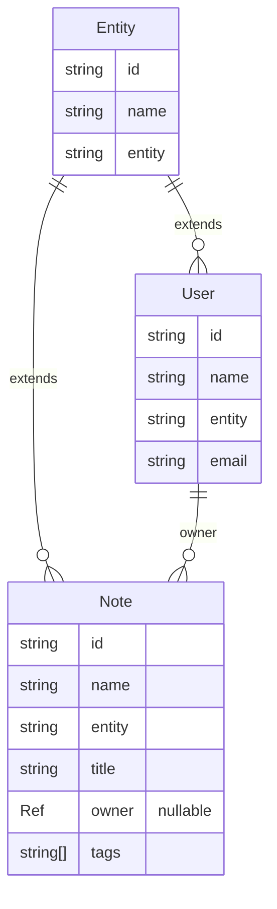

# Typed Authoring & Generated Products

Canonical definitions can be authored as typed TypeScript without changing validation. `defineEntities` serializes the typed document and runs it through the same `EntityDefinitions.load` validator used for `entities.json`.

```ts
import { Cardinality, FieldType, defineEntities } from 'basis/server'

export default defineEntities({
  entities: [
    {
      fields: [
        { field: 'email', type: FieldType.String },
        {
          cardinality: Cardinality.Many,
          field: 'notes',
          inverse: 'owner',
          target: 'Note',
          type: FieldType.Inverse,
        },
      ],
      name: 'User',
    },
    {
      fields: [
        { field: 'title', type: FieldType.String },
        { field: 'owner', inverse: 'notes', target: 'User', type: FieldType.Entity },
        { field: 'tags', items: { type: FieldType.String }, type: FieldType.Array },
        { field: 'metadata', type: FieldType.JSON },
      ],
      name: 'Note',
    },
  ],
})
```

The typed declaration accepts the same entity, relationship, array, JSON, reference, inverse, MTI, and identity-format shapes as canonical JSON. There is no decorator syntax, second registry, or alternative validator. The resulting `EntityDefinitions` can be passed directly to `Graph`, `DDL`, or a server database configuration.

## Generated products

`generateProducts(definitions)` derives deterministic products from that one validated model:

```ts
import { generateProducts } from 'basis/server'

const products = generateProducts(entities)
```

- `types` contains entity interfaces and `*Ref` identity references. Consumers can use `Partial<T>`, `Pick<T, ...>`, or an application-owned projection type.
- `schemas` contains `create`, `output`, and `update` JSON Schemas for every entity.
- `logicalErd` and `physicalErd` contain Mermaid entity-relationship diagrams.

`generateTypes`, `generateJSONSchemas`, and `generateErd` expose the same products individually. Generation is deterministic for a fixed canonical model and must not be maintained as a second schema definition.

## Example generated output

For the typed `User`/`Note` declaration above, `generateProducts(entities).types` produces:

```ts
/** Generated from the canonical Basis entity definitions. Do not edit by hand. */

export interface Entity {
  readonly id: string
  readonly name: string
  readonly entity: string
}

export type EntityRef = Pick<Entity, 'id' | 'name' | 'entity'>

export interface User extends Entity {
  readonly entity: 'User'
  readonly email: string
}

export type UserRef = Pick<User, 'id' | 'name' | 'entity'>

export interface Note extends Entity {
  readonly entity: 'Note'
  readonly title: string
  readonly owner: UserRef | null
  readonly tags: readonly string[]
}

export type NoteRef = Pick<Note, 'id' | 'name' | 'entity'>
```

The `Note` output JSON Schema is:

```json
{
  "properties": {
    "entity": { "const": "Note", "type": "string" },
    "id": { "type": "string" },
    "name": { "type": "string" },
    "title": { "type": "string" },
    "owner": {
      "anyOf": [
        {
          "properties": {
            "entity": { "const": "User", "type": "string" },
            "id": { "type": "string" },
            "name": { "type": "string" }
          },
          "required": ["id", "name", "entity"],
          "type": "object"
        },
        { "type": "null" }
      ]
    },
    "tags": { "items": { "type": "string" }, "type": "array" }
  },
  "required": ["id", "entity", "name"],
  "type": "object"
}
```

`logicalErd` renders navigation-facing entity fields:



`physicalErd` uses the compiled table and column representation:

```mermaid
erDiagram
  Entity {
    text id
    text name
    text entity
  }
  User {
    text id
    text email
  }
  Note {
    text id
    text title
    text owner.id
    text[] tags
  }
  Entity ||--o{ User : id
  Entity ||--o{ Note : id
  User ||--o{ Note : owner.id
```

The generated outputs are values returned from the API, not committed source files. Write them to your own `generated/` directory when your application chooses to persist them.

## Authoring conventions

- `User` extends the universal `Entity` root and does not redeclare `id`, `name`, or `entity`.
- `Role` uses the root identity and entity `name`, with an optional `description`.
- Use `Entity` fields with `target` for stored references and `Inverse` fields for reciprocal navigation.
- Use `Cardinality.One` or `Cardinality.Many` on inverse declarations.
- Keep generated files generated. Edit the canonical authoring source, then regenerate.

See [Schema Inspection & Planning](./schema.mdx) for the physical compiler and migration workflow.
