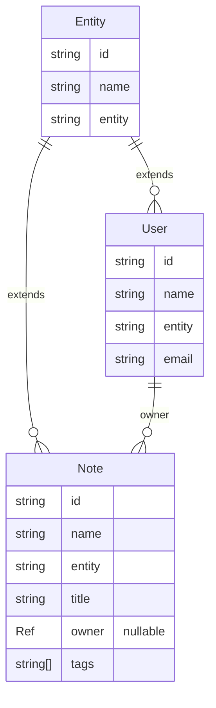

# Typed Authoring & Generated Products

`graph.ts` is the application's single authored source of truth. Importing it constructs the canonical in-memory `Graph`, which validates the complete ontology once and is the model used by query, authorization, DDL, type, schema, and ERD consumers.

```ts
import { Cardinality, FieldType, Graph } from 'basis/server'

export default new Graph({
  entities: [
    {
      fields: [
        { field: 'email', type: FieldType.String },
        {
          cardinality: Cardinality.Many,
          field: 'notes',
          inverse: 'owner',
          target: 'Note',
          type: FieldType.Inverse,
        },
      ],
      name: 'User',
    },
    {
      fields: [
        { field: 'title', type: FieldType.String },
        { default: false, field: 'active', type: FieldType.Boolean },
        { field: 'retiredAt', nullable: true, type: FieldType.Timestamp },
        { field: 'owner', inverse: 'notes', target: 'User', type: FieldType.Entity },
        { field: 'tags', items: { type: FieldType.String }, type: FieldType.Array },
        { field: 'metadata', type: FieldType.JSON },
      ],
      name: 'Note',
    },
  ],
})
```

The typed declaration accepts the same entity, relationship, array, JSON, reference, inverse, MTI, identity-format, and nullable-field shapes as canonical JSON. There is no decorator syntax, second registry, or alternative validator. Omitting `nullable` preserves the non-null default for scalar, array, and JSON fields; reference fields remain nullable by default unless `nullable: false` is declared. An optional `default` supplies the column default and must match the declared field type. JSON remains an alternate input syntax for tools that load a parsed document; it feeds the same `Graph` construction path. A `Graph` is passed directly to `Server.graph(graph)`.

Every entity inherits the update-tracking fields `lastUpdatedBy` and `lastUpdatedAt` in addition to the universal `id`, `name`, and `entity` fields. The constructed `graph.definitions` is the canonical model. Its narrow ontology queries are intentionally public: `ancestry(name)` returns the entity through its ancestors to `Entity`, `isA(name, ancestor)` includes identity, and `concreteDescendants(name)` returns concrete leaves in declaration order. A concrete entity is its own concrete descendant; abstract names are never returned as leaves; `Entity` covers every concrete leaf. Consumers use these queries instead of walking parent links themselves.

## Generated products

Build-time code generation lives outside the server runtime. Import the generators from their consumer packages and pass `graph.definitions`:

```ts
import graph from './graph'
import { generateJSONSchemas, generateTypes } from 'basis/codegen'
import { generateErd } from 'basis/visualization'

const types = generateTypes(graph)
const schemas = generateJSONSchemas(graph)
const logicalErd = generateErd(graph, 'logical')
const physicalErd = generateErd(graph, 'physical')
```

- `basis/codegen` emits entity interfaces, `*Ref` identity references, and `create`, `output`, and `update` JSON Schemas. Consumers can use `Partial<T>`, `Pick<T, ...>`, or an application-owned projection type.
- `basis/visualization` emits logical and physical Mermaid ERD source. Render it with the existing `Mermaid` component from `basis/react`; visualization never becomes a server runtime dependency.

Generation is deterministic for a fixed canonical model and must not be maintained as a second schema definition.

## Example generated output

For the typed `User`/`Note` declaration above, `generateTypes(graph)` includes these application interfaces (the system security entities are emitted too):

```ts
/** Generated from the canonical Basis entity definitions. Do not edit by hand. */

export interface Entity {
  readonly id: string
  readonly name: string
  readonly entity: string
}

export type EntityRef = Pick<Entity, 'id' | 'name' | 'entity'>

export interface User extends Entity {
  readonly entity: 'User'
  readonly email: string
}

export type UserRef = Pick<User, 'id' | 'name' | 'entity'>

export interface Note extends Entity {
  readonly entity: 'Note'
  readonly title: string
  readonly owner: UserRef | null
  readonly tags: readonly string[]
  readonly lastUpdatedBy: UserRef | null
  readonly lastUpdatedAt: string | null
}

export type NoteRef = Pick<Note, 'id' | 'name' | 'entity'>
```

The `Note` output JSON Schema is:

```json
{
  "properties": {
    "entity": { "const": "Note", "type": "string" },
    "id": { "type": "string" },
    "name": { "type": "string" },
    "title": { "type": "string" },
    "owner": {
      "anyOf": [
        {
          "properties": {
            "entity": { "const": "User", "type": "string" },
            "id": { "type": "string" },
            "name": { "type": "string" }
          },
          "required": ["id", "name", "entity"],
          "type": "object"
        },
        { "type": "null" }
      ]
    },
    "tags": { "items": { "type": "string" }, "type": "array" }
  },
  "required": ["id", "entity", "name"],
  "type": "object"
}
```

`logicalErd` renders navigation-facing entity fields:



`physicalErd` uses the compiled table and column representation:

```mermaid
erDiagram
  Entity {
    text id
    text name
    text entity
  }
  User {
    text id
    text email
  }
  Note {
    text id
    text title
    text owner.id
    text[] tags
  }
  Entity ||--o{ User : id
  Entity ||--o{ Note : id
  User ||--o{ Note : owner.id
```

The generated outputs are values returned from the API, not committed source files. Write them to your own `generated/` directory when your application chooses to persist them.

## Authoring conventions

- `User` extends the universal `Entity` root and does not redeclare `id`, `name`, or `entity`.
- `Role` uses the root identity and entity `name`, with an optional `description`.
- Use `Entity` fields with `target` for stored references and `Inverse` fields for reciprocal navigation.
- Use `Cardinality.One` or `Cardinality.Many` on inverse declarations.
- Keep generated files generated. Edit the canonical authoring source, then regenerate.

See [Schema Inspection & Planning](./schema.mdx) for the physical compiler and migration workflow.
