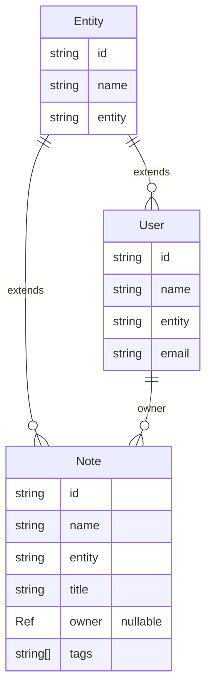

# Typed Authoring & Generated Products

`graph.ts` is the application's single authored source of truth. Importing it constructs the canonical in-memory `Graph`, which validates the complete ontology once and is the model used by query, authorization, DDL, type, schema, and ERD consumers.

```ts
import { Cardinality, Constraint, FieldType, Graph } from 'basis/server'

export default new Graph({
  entities: [
    {
      fields: [
        { field: 'email', type: FieldType.String },
        {
          cardinality: Cardinality.Many,
          field: 'notes',
          inverse: 'owner',
          target: 'Note',
          type: FieldType.Inverse,
        },
      ],
      name: 'User',
    },
    {
      fields: [
        { field: 'title', type: FieldType.String },
        { default: false, field: 'active', type: FieldType.Boolean },
        { field: 'email', type: FieldType.String, unique: true },
        { field: 'retiredAt', nullable: true, type: FieldType.Timestamp },
        { field: 'owner', inverse: 'notes', target: 'User', type: FieldType.Entity },
        { field: 'tags', items: { type: FieldType.String }, type: FieldType.Array },
        { field: 'metadata', type: FieldType.JSON },
      ],
      name: 'Note',
    },
    {
      constraints: [{
        description: 'Each user may only have one Membership per Campaign.',
        fields: ['userId', 'campaignId'],
        name: 'One Membership Per Campaign',
        type: Constraint.Uniqueness,
      }],
      fields: [
        { field: 'userId', target: 'User', type: FieldType.Entity },
        { field: 'campaignId', target: 'Campaign', type: FieldType.Entity },
      ],
      name: 'Membership',
    },
    { fields: [], name: 'Campaign' },
  ],
})
```

The typed declaration accepts the same entity, relationship, array, JSON, reference, inverse, MTI, identity-format, nullable, default, and uniqueness shapes as canonical JSON. There is no decorator syntax, second registry, or alternative validator. Omitting `nullable` preserves the non-null default for scalar, array, and JSON fields; reference fields remain nullable by default unless `nullable: false` is declared. An optional `default` supplies the column default and must match the declared field type. `unique: true` and named `Constraint.Uniqueness` declarations normalize into PostgreSQL unique indexes through the same Graph/DDL path. `Number` fields may declare inclusive `minimum`/`maximum`; `String` fields may declare `minLength`/`maxLength`. These bounds are canonical Graph metadata, validation constraints for mutations, and PostgreSQL `CHECK` constraints, not a mutation-only schema. JSON remains an alternate input syntax for tools that load a parsed document; it feeds the same `Graph` construction path. A `Graph` is passed directly to `Server.graph(graph)`.

Every entity inherits the update-tracking fields `lastUpdatedBy` and `lastUpdatedAt` in addition to the universal `id`, `name`, and `entity` fields. The constructed `graph.definitions` is the canonical model. Its narrow ontology queries are intentionally public: `ancestry(name)` returns the entity through its ancestors to `Entity`, `isA(name, ancestor)` includes identity, and `concreteDescendants(name)` returns concrete leaves in declaration order. A concrete entity is its own concrete descendant; abstract names are never returned as leaves; `Entity` covers every concrete leaf. Consumers use these queries instead of walking parent links themselves.

## Generated products

Build-time code generation lives outside the server runtime. The application root supplies a default-exported `graph.ts`; `basis emit` constructs that Graph once, runs the built-in emitters, and then discovers default-exported modules in `emitters/` by convention:

```ts
// graph.ts
import { FieldType, Graph } from 'basis/server'

export default new Graph({ entities: [{ fields: [{ field: 'title', type: FieldType.String }], name: 'Note' }] })
```

```ts
// emitters/CustomEmitter.ts
import { emitter } from 'basis/codegen'

export default emitter({ extension: 'txt', folder: 'custom' }, graph => [{
  content: graph.definitions.entities.map(entity => entity.name).join('\n'),
  name: 'summary',
}])
```

`basis emit` writes beneath `generated/`; `basis typecheck` and `basis check` run the same lifecycle automatically. No configuration lists emitters, and no custom bundle stage is required.

- Built-in `TypeScriptEmitter` writes `generated/typescript/index.ts`; `JsonSchemaEmitter` writes `generated/json-schema/schemas.json`. Application emitters own their extension, folder, file names, and content.
- `basis/codegen` also exports the pure content generators `generateTypes(graph)` and `generateJSONSchemas(graph)` for consumers that own their own file emission.
- The JSON Schema emitter uses the same canonical metadata as mutation validation: create excludes the generated `entity` discriminator, allows an optional supplied `id`, requires non-null writable fields, and rejects unknown fields with `additionalProperties: false`; update excludes generated/readonly fields. Output schemas and TypeScript types include `null` only where canonical nullability allows it. Identity schemas use the entity's canonical UUID/Snowflake pattern, and a Snowflake entity requires `id` on create. Numeric/string bounds and required fields match mutation validation rather than forming a second DTO. Consumers can use `Partial<T>`, `Pick<T, ...>`, or an application-owned projection type.
- `basis/visualization` emits logical and physical Mermaid ERD source. Render it with the existing `Mermaid` component from `basis/react`; visualization never becomes a server runtime dependency.

Emitter modules use the small `emitter({ extension, folder }, generate)` contract. The factory returns an awaitable `(graph, root?) => Promise<void>` and writes each generated file beneath the caller's root; the module owns its extension, folder, file names, and format-specific content. The output root defaults to the process working directory, and declared destinations cannot escape it. The conventional lifecycle invokes application emitters in sorted filename order, so repeated runs overwrite deterministic paths; no stale files are deleted.

Generation is deterministic for a fixed canonical model and must not be maintained as a second schema definition.

## Example generated output

For the typed `User`/`Note` declaration above, the TypeScript emitter includes an entity enum, parent-composed interfaces, refs, and typed maps:

```ts
/** Generated from the canonical Basis entity definitions. Do not edit by hand. */

export enum Entities {
  User = 'User',
  Note = 'Note',
}

export interface Entity {
  readonly id: string
  readonly name: string
  readonly entity: Entities
  readonly lastUpdatedBy: UserRef | null
  readonly lastUpdatedAt: string | null
}

export type EntityRef = Pick<Entity, 'id' | 'name' | 'entity'>

export interface User extends Entity {
  readonly entity: Entities.User
  readonly email: string
}

export type UserRef = Pick<User, 'id' | 'name' | 'entity'>

export interface Note extends Entity {
  readonly entity: Entities.Note
  readonly title: string
  readonly owner: UserRef | null
  readonly tags: readonly string[]
}

export type NoteRef = Pick<Note, 'id' | 'name' | 'entity'>

export interface EntityMap {
  readonly User: User
  readonly Note: Note
}

export interface CreateMap {
  readonly User: UserCreate
  readonly Note: NoteCreate
}

export interface UpdateMap {
  readonly User: UserUpdate
  readonly Note: NoteUpdate
}
```

Child entities extend their generated direct parent and declare only locally owned fields, while concrete discriminators narrow the abstract parent union. `CreateMap` uses canonical identity strings for references; hydrated entity maps use the corresponding `*Ref` objects.

The generated maps connect to typed queries and mutations through the server facade:

```ts
import { typedDatabase } from 'basis/server'
import type { CreateMap, EntityMap, ReferenceMap, UpdateMap } from './generated/typescript'

const db = typedDatabase<EntityMap, CreateMap, UpdateMap, ReferenceMap>(server.db)
const notes = await db.query('Note', {
  fields: ['id', 'title', 'owner.email'],
})
const created = await db.create('Note', {
  name: 'Welcome',
  owner: user.id,
  title: 'Welcome',
})
```

Query fields are constrained to supported effective-field and reference paths. Invalid fields, array-index projections, mismatched result types, reference objects in create payloads, and identity changes in edits fail TypeScript compilation.

The JSON Schema emitter produces self-contained `$defs`/`$ref` schemas with shared field definitions and inheritance-aware required/nullability rules. Create, update, and output variants remain distinct and reject unknown properties:

```json
{
  "$defs": {
    "Entity_name_create": { "type": "string" },
    "Note_title_create": { "type": "string" },
    "Note_owner_create": { "type": ["string", "null"] }
  },
  "additionalProperties": false,
  "properties": {
    "id": { "pattern": "...", "type": "string" },
    "name": { "$ref": "#/$defs/Entity_name_create" },
    "title": { "$ref": "#/$defs/Note_title_create" },
    "owner": { "$ref": "#/$defs/Note_owner_create" }
  },
  "required": ["name", "title"],
  "type": "object"
}
```

`logicalErd` renders navigation-facing entity fields:



`physicalErd` uses the compiled table and column representation:

```mermaid
erDiagram
  Entity {
    text id
    text name
    text entity
  }
  User {
    text id
    text email
  }
  Note {
    text id
    text title
    text owner.id
    text[] tags
  }
  Entity ||--o{ User : id
  Entity ||--o{ Note : id
  User ||--o{ Note : owner.id
```

The generated outputs are values returned from the API, not committed source files. Write them to your own `generated/` directory when your application chooses to persist them.

## Authoring conventions

- `User` extends the universal `Entity` root and does not redeclare `id`, `name`, or `entity`.
- `Role` uses the root identity and entity `name`, with an optional `description`.
- Use `Entity` fields with `target` for stored references and `Inverse` fields for reciprocal navigation.
- Use `Cardinality.One` or `Cardinality.Many` on inverse declarations.
- Keep generated files generated. Edit the canonical authoring source, then regenerate.

See [Schema Inspection & Planning](./schema.mdx) for the physical compiler and migration workflow.
