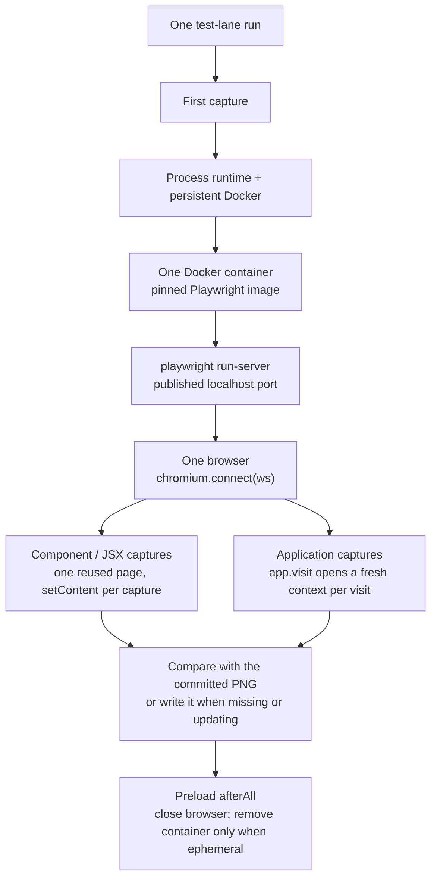

# Testing & Visual Snapshots

Snapshot tests pin the rendered output of a component or an application page to a committed PNG. `basis/testing` exposes one async helper, `matchScreenshot(subject, hint?, options?)`, with the same shape as Bun's `toMatchSnapshot`: a missing snapshot is written, a changed snapshot throws (the diff is kept in memory and nothing is written to disk), and `--update-snapshots` (or `UPDATE_SNAPSHOTS=1`) rewrites it. The subject is a React element, a Playwright `Page`, or a `Locator`.

## Test lanes

A test file's suffix selects its lane. Bun's default discovery runs only `.test` and `.spec`; the screenshot and end-to-end lanes stay opt-in and run only when a command names their files explicitly.

| Suffix                                                  | Purpose                                                                                             | Default `bun test`? | Canonical command  |
| ------------------------------------------------------- | --------------------------------------------------------------------------------------------------- | ------------------- | ------------------ |
| `*.test.ts` / `*.test.tsx` (including `*.dom.test.tsx`) | Pure model/store/server tests and mounted Basis component tests via `render`, `Simulate`, `waitFor` | Yes                 | `bun test`         |
| `*.screenshot.tsx` / `*.screenshot.ts`                  | Component-level visual-regression contracts via `matchScreenshot`; no application mount             | No                  | `test:screenshots` |
| `*.e2e.ts` / `*.e2e.tsx`                                | Feature-level `useApplication().visit()` journeys in a real browser; may capture screenshots        | No                  | `test:e2e`         |

```json
{
  "scripts": {
    "test": "bun run test:unit",
    "test:unit": "bun test ./source/unit/**/*.test.ts",
    "test:coverage": "bun run test:unit --coverage",
    "test:component": "bun test ./source/components/**/*.test.tsx",
    "test:contract": "bun test ./source/contract/*.test.ts",
    "test:server": "bun test ./source/server/*.test.ts",
    "test:lifecycle": "bun test ./source/lifecycle/*.test.ts",
    "test:screenshots": "bun test ./source/visual/captures/*.screenshot.tsx",
    "test:e2e": "bun test ./source/e2e/*.e2e.ts",
    "test:e2e:visual": "bun test ./source/e2e/visual/*.e2e.ts",
    "test:e2e:database-fixtures": "bun test ./source/e2e/fixtures/database/*.e2e.ts",
    "test:e2e:fixtures": "bun run test:e2e:database-fixtures && bun test ./source/e2e/fixtures/*.e2e.ts",
    "test:e2e:all": "bun run test:e2e && bun run test:e2e:visual && bun run test:e2e:fixtures",
    "test:all": "bun run test:unit && bun run test:component && bun run test:contract && bun run test:server && bun run test:lifecycle && bun run test:screenshots && bun run test:e2e:all"
  }
}
```

Explicit file paths execute the custom suffixes under the pinned Bun version. Shell-expanded `*` globs work when a lane lives in a flat directory, such as `./source/visual/captures/*.screenshot.tsx`; for a nested tree, pass the files explicitly (Basis's own lane scripts collect them with `find`). Do not add `[test].pathIgnorePatterns` or `--path-ignore-patterns`. Keep `[test] preload = ["basis/testing/bun"]`; the preload supplies the shared browser lifecycle and pruning. The reference CI workflow runs `test:screenshots`, `test:e2e`, `test:e2e:visual`, and `test:e2e:fixtures` as separate steps in the impact-selected Visual job. `test:unit` is the ordinary warm lane; component, contract, server, lifecycle, browser-visual, and database fixture/seed tests have their own commands. Coverage is opt-in with `test:coverage`. The database fixture lane owns independent-install, restart, and prebuilt 500k-row seed proofs so ordinary behavior E2E never pays their container setup cost. `test:all` is deliberate full acceptance, not the ordinary edit loop.

Basis recognizes all three lanes when it attributes a caller, registers a test, and scopes orphan pruning. That recognition never makes a heavy lane a default test: Bun still discovers only `.test` and `.spec`.

Visual snapshots assert appearance; mounted component tests assert behavior; end-to-end journeys validate actual browser and integration boundaries.

A test-lane run is fast and deterministic because the expensive part — the browser — is paid for once and reused:

- one version-and-runtime-named Docker container serves Chromium for the run and is reused by later runs;
- exactly **one browser connection** serves every capture;
- component/JSX snapshots and `app.visit` snapshots share that one browser;
- the runtime starts on the first capture, never per file, test, assertion, visit, or component;
- the testing preload closes the browser and contexts once when the run ends; the container is removed only in explicit ephemeral mode.

## Lifecycle



The runtime is memoised on `globalThis`, so every test file in the process resolves the same instance. There is no per-file, per-test, or per-capture browser startup; a run that never captures a screenshot never starts Docker at all.

## Component captures

`matchScreenshot(<Button>Save</Button>)` renders the element to a standalone document with `react-dom/server`, inlines Basis's component styles and default theme, and loads it into one reused page with `setContent`. Each capture replaces that page's document, so the page — and the browser behind it — is created once. Playwright round-trips are kept to a minimum: one `evaluate` that waits for fonts and measures the element, then one screenshot. Put these captures in `*.screenshot.tsx` and run them with `bun run test:screenshots`.

Components whose meaningful state only exists after mount — the resolved `Await`, a rendered `Mermaid` diagram, a placed `Tooltip` — are captured live through `app.visit` in `visual.live.e2e.ts`. Everything else is a static element capture.

## Application captures

`useApplication({ entry })` attaches to one detached development server per application identity, starts it on a free loopback port when necessary, waits for readiness, and reuses it across runs with HMR enabled. `app.visit(path, options?, fn)` opens a fresh browser context on the shared browser, applies the deterministic network policy, navigates, and runs the callback. Contexts are cheap: they keep server and browser state from leaking between visits without paying for a new browser. Set `BASIS_APPLICATION_FIXTURE_EPHEMERAL=1` for a run-scoped server that the preload stops; `BASIS_APPLICATION_FIXTURE_ROOT` overrides the persistent fixture directory.

```tsx
// Deck.e2e.ts
import { matchScreenshot, test, useApplication } from 'basis/testing'

test('renders the application', async () => {
  const app = await useApplication({ entry: './src/serve.ts' })

  await app.visit('/deck', async page => {
    await matchScreenshot(page.locator('.deck-builder'))
  })
})
```

Application journeys live in `*.e2e.ts` (or `*.e2e.tsx`) and run with `bun run test:e2e`. Docs highlighting is locally pinned through `shiki` and Mermaid uses the local SSR-capable renderer, so visual journeys do not fetch a CDN. The behavior lane excludes the browser-heavy docs captures and the fixture lifecycle proofs; run those with `bun run test:e2e:visual` and `bun run test:e2e:fixtures`. `test:e2e:all` aggregates all three. Component appearance belongs in `*.screenshot.tsx` and runs with `bun run test:screenshots`; none of these are part of the default `bun test` lane.

## Run-scoped cleanup

`registerRunCleanup(callback)` registers teardown for an in-process resource that needs process-wide cleanup but cannot use a child application handle. The callback runs once after the suite, including after failures, and during `SIGINT`/`SIGTERM` teardown. Use it for narrow fixtures such as an in-process database handle that tests must access directly; it is not a general application or resource manager.

## Consumer database fixtures

`basis/testing` exports `withIsolatedDatabase` and `withDurableDatabase` with the same fixture implementation Basis uses. Pass the consumer's entity definitions explicitly to prepare and query that model in a transaction-isolated schema:

```ts
import { EntityDefinitions } from 'basis/server'
import { withIsolatedDatabase } from 'basis/testing'

const entities = EntityDefinitions.load(JSON.stringify({
  entities: [{
    fields: [{ field: 'id', format: 'UUID' }, { field: 'label', type: 'String' }],
    name: 'ConsumerNote',
  }],
}))

await withIsolatedDatabase('consumer', async database => {
  await database.sql`INSERT INTO "Entity" ("id", "name", "entity") VALUES (... )`
  await database.sql`INSERT INTO "ConsumerNote" ("id", "label") VALUES (... )`
  const rows = await database.query('ConsumerNote', { fields: ['id', 'label'] })
}, { entities })
```

`test:consumer` proves this import and a real PostgreSQL transaction from a fresh Git-dependency install.

## Database isolation

Server database tests reuse one managed PostgreSQL service per checkout. The fixture keeps the container between runs and caches one migrated schema per exact entity-definition set; the first run creates it and later runs reuse it. Ordinary tests run inside one reserved transaction, set the cached schema, use savepoints for expected failures, and roll everything back whether the test succeeds or fails. DDL, data, `db.sql`, and entity-rooted `db.query` share that transaction. Cross-transaction tests use an explicitly committed unique schema and drop it in cleanup instead of pretending commit behavior can roll back. Fixture lifecycle proofs set `BASIS_DATABASE_FIXTURE_EPHEMERAL=1` when they need explicit container removal; `BASIS_TEST_FIXTURE_ROOT` overrides the persistent fixture directory.

### Golden SQL assertions

Server database tests assert complete SQL statements, not fragments. Register the test-only `toMatchSQL` matcher from `libraries/server/testing/toMatchSQL.ts`:

```ts
import { expect } from 'bun:test'
import { toMatchSQL } from '../testing/toMatchSQL'

expect.extend({ toMatchSQL })
expect(statement).toMatchSQL(`SELECT "id" FROM "Note" WHERE "id" = $1`)
```

The matcher normalizes only insignificant whitespace outside quoted text; quoting, keywords, operators, placeholders, and ordered statement arrays remain significant. Dollar-quoted string contents, backslash escapes in `E'…'` strings, and line/nested block comment text—including line-comment newlines—are preserved rather than normalized. Use complete golden statements for phased DDL and compiled queries, and assert ordered bind values separately from their SQL text.

## Docker and determinism

Capture always runs in the pinned `mcr.microsoft.com/playwright:v<installed playwright>-noble` image, matching the installed Playwright version, so local development and CI render in the same browser. No host Chromium or operating-system libraries are needed — only a working Docker daemon. The runtime publishes the container's `run-server` to a random localhost port and connects once with `chromium.connect`, exposing the client's loopback so the containerised browser can reach the application server; the container is named from the installed Playwright version and the mounted Playwright runtime identity, and uses no host-network assumption.

The container is named from the installed Playwright version. A normal development run reconnects to that healthy named run-server; an explicit ephemeral run uses a process-unique name and removes it at teardown. Browser contexts remain isolated per visit, and the component capture page remains reused within the process.

## Proving the contract

`libraries/testing/runtime.lifecycle.e2e.ts` is the benchmark. It generates several test files — dozens of component snapshots, repeated captures within one test, and multiple `app.visit` snapshots — and runs them in one real child `bun test` process with `BASIS_SNAPSHOT_FIXTURE_EPHEMERAL=1`. The runtime records its lifecycle events to `BASIS_SNAPSHOT_ACTIVITY_LOG`, and the test asserts **one ephemeral container start, one browser connection, and one teardown** for the run, reporting the measured runtime. Normal visual runs attach to the version-named persistent container instead of launching again.

## Temp directories

The testing preload isolates the process temp directory: it points `TMPDIR` / `TMP` / `TEMP` at one run-scoped root, so `os.tmpdir()` — and therefore `mkdtemp`, any dependency, or any spawned child that uses it — writes inside that root. The preload removes the root when the run ends — success, failure, thrown error, or `SIGINT` / `SIGTERM` — so a detonating test cannot leak a directory or its contents, with no per-repo configuration.

For a fixture that wants a named directory, `tempDirectory(prefix, base?)` from `basis/testing` creates a fresh directory under the same isolated root:

```ts
import { tempDirectory } from 'basis/testing'

const directory = tempDirectory('my-fixture')
```

Plain `mkdtemp(os.tmpdir())` is captured the same way. The optional `base` places the run root elsewhere, for a fixture a tool resolves only below the working tree; a base the run created is removed again once empty.

## Updating snapshots

```sh
# Fast lane
bun test --update-snapshots

# A visual or end-to-end lane
bun run test:screenshots --update-snapshots
bun run test:e2e --update-snapshots

# Or set the environment variable for any lane
UPDATE_SNAPSHOTS=1 bun run test:screenshots
```

A committed baseline is only rewritten when the run explicitly updates. A failed or browser-less run never mutates a committed snapshot; a comparison failure writes nothing, and any legacy `.actual` / `.diff` artefacts from an older run are cleared on the next pass. Obsolete snapshots are pruned only while updating, and only for files whose entire suite executed.
